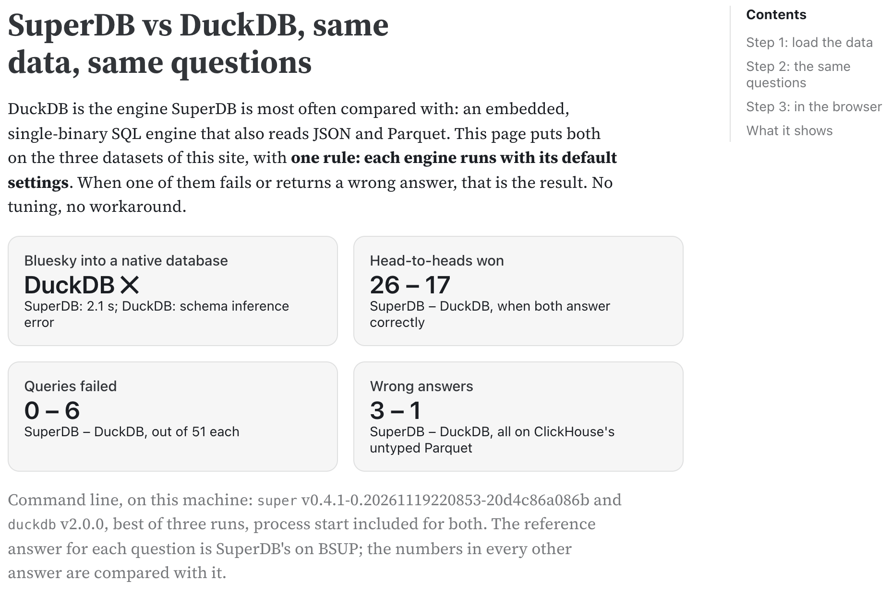
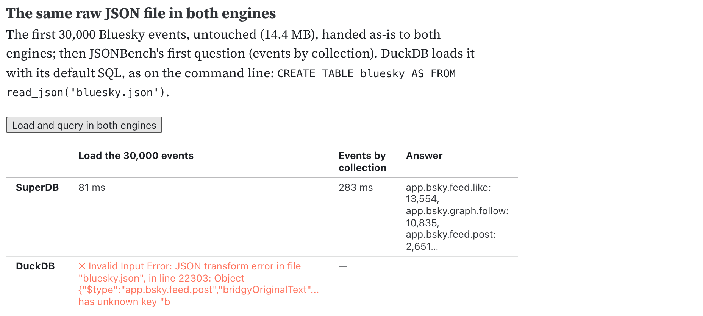
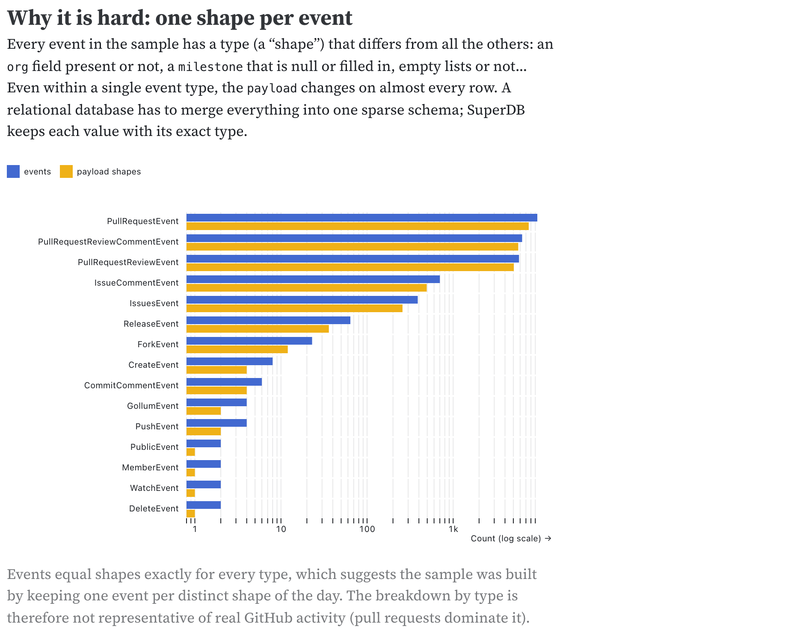
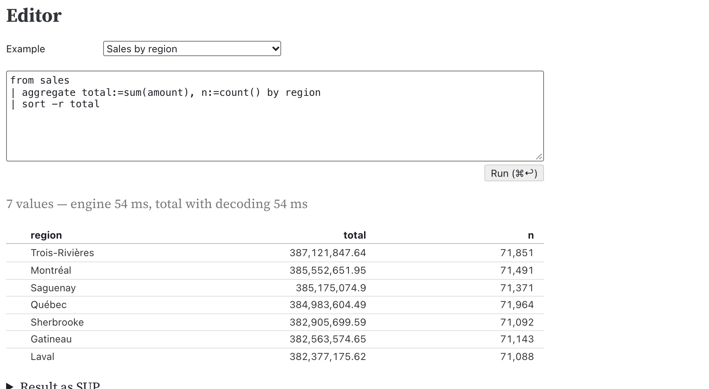
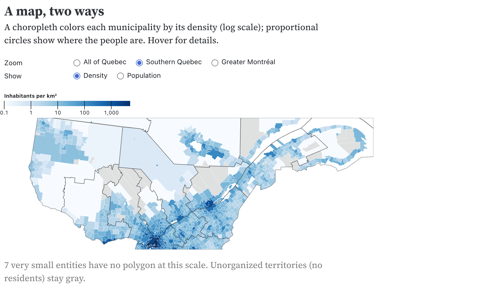
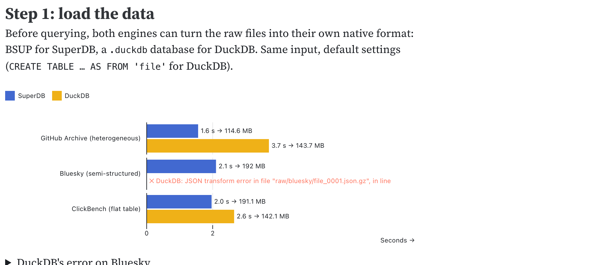
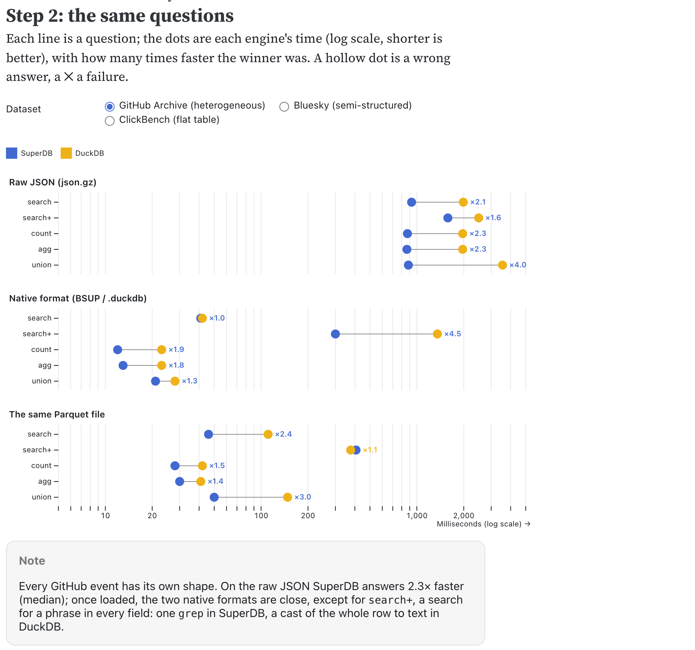
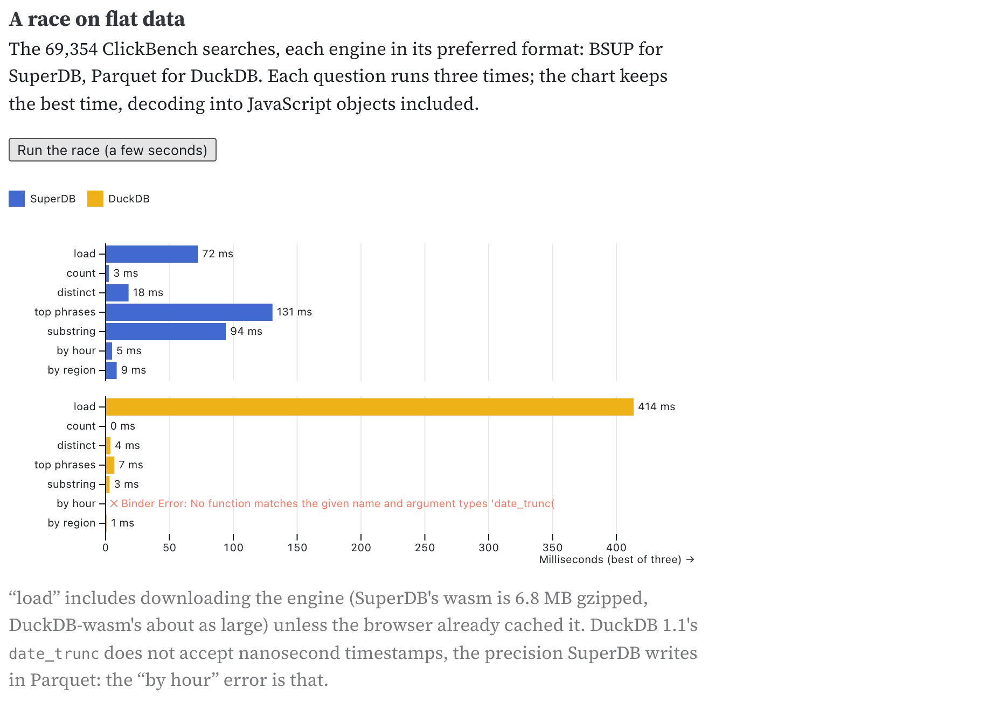

# SuperDB × Observable Framework: a proposal

*Gilles Clément, November 20, 2026. The working prototype, demo site and measurements are in a public repository,
[`superdb/super-observable`](https://github.com/superdb/super-observable).*

## TL;DR

- **Observable Framework is where many analysts pick a data engine, and today that engine is DuckDB.**
  Framework ships DuckDB-wasm built in: `sql` code blocks, `sql:` front matter and `DuckDBClient` all point to it.
  SuperDB has no place there yet.
- **I built that place, and it works.** It has two layers:
  - **build-time data loaders** that run `super` and ship BSUP;
  - **the SuperDB engine compiled to wasm**, running in a Web Worker behind a `SuperDBClient` that implements
    Observable's `DatabaseClient` interface, the same contract `DuckDBClient` follows.
  - With build tags that leave out Arrow, Parquet and S3, the wasm drops from 96 MB to 32 MB (6.8 MB gzip).
- **A bilingual demo site (English and French) exercises it on public data:**
  - GitHub Archive;
  - 1 M Bluesky events (JSONBench);
  - ClickBench;
  - Quebec open data;
  - a head-to-head with DuckDB.
- **The DuckDB comparison has one rule: default settings for both engines.** A failure or a wrong answer is a result.
  Two outcomes stand out:
  - **DuckDB cannot load the Bluesky file into its own database.** It infers a schema from a sample, and a field first
    seen at line 22,303 breaks the load. This happens both on the command line and in the browser. SuperDB loads it
    in 2.1 s on the command line and loads the 30,000-event browser sample in 81 ms.
  - **SuperDB is 1.6–4× faster on raw heterogeneous JSON (GitHub Archive), median 2.3×.** A search across every field takes one
    `grep`, and it is 4.5× faster than DuckDB's equivalent.
- **DuckDB is still clearly ahead on flat data.** Heavy ClickBench queries are 3–11× faster, Parquet is faster,
  in-browser queries on flat data are faster, and its database files are smaller.
- **Silent wrong answers on untyped Parquet bytes.** On ClickHouse's Parquet, whose strings are untyped bytes, SuperDB
  returns wrong answers without any error: `LIKE` on `bytes` is `false`, and `<>` produces an error value that `WHERE`
  drops. DuckDB refuses the same query loudly. This is worth fixing (§3).
- **I'm ready to turn this into pull requests:**
  - build tags and a wasm entry point in `superdb/super`;
  - the client in `superdb/super-ts`;
  - a docs page.
  The Framework-side integration is optional (§2).


*The comparison page opens with the score. Every number comes from the command-line runs in §5.*


*Live in the browser: the same 30,000 raw Bluesky events. SuperDB loads them in 81 ms; DuckDB-wasm, with its default `read_json`, stops at line 22,303.*

---

## 1. The proposal and why it matters

### What Observable Framework is

[Observable Framework](https://observablehq.com/framework/) is an open-source static-site generator for data apps and
dashboards. Pages are Markdown with reactive JavaScript cells. Data comes from **data loaders**, programs in any
language that run at build time and write a file. The site is static, and queries can also run in the browser.

### Why this is a good place for SuperDB

- **DuckDB is the default SQL engine.** Framework bundles DuckDB-wasm (version 1.29, i.e. DuckDB 1.1.1). Every
  `sql` block, the `sql:` front matter and `DuckDBClient` go through it. A Framework user who wants SQL meets DuckDB
  first, and only DuckDB.
- **The audience is large, and it is the audience SuperDB wants.** Analysts and data engineers who publish dashboards
  are the people who wrestle with messy JSON. Public npm downloads for the last month (2026-10-21 to 2026-11-19) give
  an order of magnitude:

  | Package | Monthly downloads |
  |---|---:|
  | `@observablehq/framework` | 77,248 |
  | `@observablehq/plot` | 6.18 M |
  | `@duckdb/duckdb-wasm` | 3.28 M |

  - Framework also has 3,683 GitHub stars; `superdb/super` has 1,577.
  - Downloads are not users: CI builds count too, and Plot is also used outside Framework. They do show that the
    Observable ecosystem, and DuckDB's place in it, is large.
- **The gap is easy to see.** As soon as the data is heterogeneous, DuckDB in Framework stumbles. The Bluesky load
  error happens with the defaults, on public data, in a few lines of code. The demo shows it live in the browser. A
  native SuperDB option turns that moment into a reason to try SuperDB.


*GitHub Archive: as many payload shapes as events. This is the data a relational engine has to flatten, and the data SuperDB keeps as is.*
- **Data loaders fit SuperDB naturally.** A loader is just a command that writes to stdout:
  `super -f bsup -c "from 'raw/*.json.gz' | …"` is a complete loader. BSUP keeps every type, including heterogeneous
  shapes, unions, named types, errors, IP addresses and durations, that JSON and Arrow lose on the way to the browser.

### Architecture

```
            build time                              │                    browser
                                                    │
 raw data ──▶ data loader: super -f bsup ──▶ .bsup ─┼──▶ super-ts decodeBSUP ──▶ JS objects ──▶ Plot / Inputs
 (JSON, CSV,   (src/data/*.bsup.sh)                 │     (level 1: precomputed results)
  Parquet…)                                         │
                                                    │──▶ SuperDBClient ──postMessage──▶ Web Worker
                                                    │     .query / .sql`…`              super.wasm (Go)
                                                    │     .describeColumns              register(name, bytes)
                                                    │                                    run(query) → BSUP
                                                    │     (level 2: interactive SuperSQL on the client)
```

**Level 1: build time.**
- Loaders run `super` and emit BSUP.
- `loadBSUP(FileAttachment(...))` decodes the file with `super-ts` into plain JS objects for Plot and Inputs.
- The super-typed values stay reachable through a non-enumerable `.values` property, for example to show types or
  SUP.

**Level 2: SuperDB in the browser.**
- The Go engine is compiled to wasm and runs in a Web Worker, so the page never freezes.
- `SuperDBClient` mirrors `DuckDBClient`:

```js
import {SuperDBClient} from "./components/superdb-client.js";
const db = await SuperDBClient.of({gha: FileAttachment("data/gha/events.bsup")});
const rows = await db.sql`from gha | where repo.name = ${repo} | aggregate count() by type`;
```

- The client implements Observable's `DatabaseClient` interface: `query`, `queryRow`, `queryStream`,
  `describeTables` and `describeColumns`. That interface is what `Inputs.table`, the data table cell and other
  Observable tools expect.
- `describeColumns` is SuperDB-aware. It takes the union of the fields of every shape in the source, so a field with
  several types reports, for example, `int64 | string`.


*The live SuperSQL editor: the engine runs in the page, in a Web Worker, with no server.*
- Sources can be `FileAttachment`s (the worker downloads them), bytes, strings or arrays of objects. The format is
  detected from the content.
- `db.sql` template parameters are inserted as SuperSQL literals. `db.query(q, params)` accepts positional `?`
  parameters, like DuckDB.

---

## 2. How to build it: the proposed change

The prototype works today without changing anything upstream. Making it a proper native SuperDB option is three
small, independent pieces of work. I can turn each one into a pull request.

### 2.1 In `superdb/super`: an official wasm build

**Build tags to leave out heavy dependencies.** `wasm/super-wasm.patch` is a 311-line diff:
- It moves Arrow and Parquet behind `noarrow`. `sio/anyio/arrow.go` and `arrow_none.go` hold the real and stub
  constructors, and `lookup.go` calls them instead of `arrowio` and `parquetio` directly.
- It moves S3 behind `nos3` (`pkg/storage/s3.go` and `s3_none.go`).
- The default build is unchanged. The stubs return clear errors ("Arrow and Parquet support not included in this
  build").

Effect on `GOOS=js GOARCH=wasm`:

| Build | Raw | gzip | brotli |
|---|---:|---:|---:|
| Full | 96 MB | 16.4 MB | 10.9 MB |
| `-tags noarrow,nos3` | **32 MB** | **6.8 MB** | **4.6 MB** |

**A wasm entry point for a long-lived engine.** `book/super-example/main.go` already compiles SuperDB to wasm for the
docs, but it runs one query on one input stream. `wasm/main.go` exposes a persistent engine on `globalThis.__superdb`:
- `register(name, Uint8Array)` and `unregister(name)`: in-memory sources that `from name` resolves to. They implement
  `storage.Engine` with random access and known size, which columnar BSUP frames need.
- `names()`, `version`.
- `run(query, format = "bsup")`: returns a `Promise<Uint8Array>`. Panics are recovered and returned as errors.

Proposed location: `cmd/super-wasm/` or a `wasm/` package, with a `make wasm` target and a release artifact.

**Possible follow-ups:**
- streaming results, chunked BSUP through `ReadableStream`;
- reading registered sources lazily over HTTP range requests instead of fully into memory;
- an optional Parquet-enabled variant for people who need it.

### 2.2 In `superdb/super-ts`: the client

`super-ts` already decodes BSUP and models super-structured values. I propose adding:
- `SuperDBClient`: about 230 lines, with the worker inlined as a Blob so bundlers have no extra file to resolve, and
  the `DatabaseClient` methods described above. It works in any web page, not only Framework.
- `loadBSUP(file)`: rows plus `.values`, for build-time results.
- `literal(v)`: JS value → SuperSQL literal, for safe parameters.

Then publish both the package and the wasm on npm, for example as `@superdb/super-ts` with `@superdb/wasm`. Framework
pages could then use `import {SuperDBClient} from "npm:@superdb/super-ts"` with nothing copied into the project.

### 2.3 In Observable Framework (optional, for later)

True parity with DuckDB would mean:
- ` ```supersql ` fenced blocks;
- a `superdb:` front matter key, like `sql:`;
- a built-in `FileAttachment.bsup()`.

These are hard-coded for DuckDB in Framework's Markdown transform, so they need a pull request to
`observablehq/framework`. Framework's latest release is v1.13.4 (2026-03-02), and the repository has had no push since
2026-05-15. I would not make the integration depend on it. Sections 2.1 and 2.2 already give Framework users a native
experience through `npm:` imports.

### 2.4 Docs

- A `book/src` page: "Using SuperDB with Observable Framework" (data loaders, BSUP, `SuperDBClient`).
- A link to the demo site as a worked example.

---

## 3. Improvements to SuperDB suggested by the comparison

Each item below comes from a measurement or an observed failure. Times are command-line, best of three, process start
included.

1. **Silent wrong answers on `bytes`.** This is the most important one, because it is about correctness.

   ```
   echo '{u:0x676f6f676c65}' | super -s -c "values {like:u LIKE '%oo%', ne:u <> ''}" -
   {like:false,ne:error("type mismatch: bytes != string")}
   ```

   - `LIKE` on `bytes` returns `false` instead of an error.
   - `<>` returns an error value, and `WHERE` drops it silently.
   - With constants, the compiler does report the type mismatch. With data, it doesn't.
   - On ClickHouse's Parquet (string columns stored as `BYTE_ARRAY` without a `STRING` annotation), Q20 returns
     `count: 0` instead of 95 and Q12 returns no rows. DuckDB refuses Q20 with a type error.
   - Suggestions:
     - make `LIKE` on `bytes` an error;
     - surface errors dropped by `WHERE`, at least as a warning;
     - consider an option, or a heuristic, to read unannotated Parquet `BYTE_ARRAY` as `string`.
2. **Heavy aggregations on flat columnar data.** On ClickBench in native format, the light queries are a draw decided
   by process start, but heavy ones are not:

   | Query | DuckDB | SuperDB | DuckDB ahead by |
   |---|---:|---:|---:|
   | Q33 (`GROUP BY URL`) | 33 ms | 373 ms | 11× |
   | Q20 (`LIKE`) | 29 ms | 93 ms | 3.2× |
   | Q12 (`GROUP BY` on a string) | 24 ms | 40 ms | 1.7× |

   Hash aggregation on strings and vectorized `LIKE` look like the places to work.
3. **Parquet query speed.**
   - On Bluesky's Parquet, DuckDB is 1.2–4.5× faster (q4: 51 ms against 186 ms; q5: 52 ms against 232 ms).
   - On GHA's Parquet, SuperDB wins 4 of 5 questions.
4. **Raw JSON read speed on mostly regular data.**
   - On Bluesky's `json.gz`, DuckDB answers in about 0.97 s and SuperDB in about 1.8 s, every question.
   - On heterogeneous GHA JSON the order is reversed, with SuperDB 1.6–4× faster.
   - The JSON reader seems to leave speed on the table when the shapes repeat.
5. **Parquet writing of empty records.**
   - `super -f parquet` fails on the full Bluesky file (`unsupported type: empty record`).
   - The demo had to write Parquet without `commit.record`.
6. **Browser query latency.**
   - On the 69,354 ClickBench searches, DuckDB-wasm on Parquet answers in 0–7 ms. SuperDB wasm on BSUP takes 2–136 ms,
     including the decode into JS objects.
   - Part of that cost is `super-ts` decoding. A columnar result path, or decoding lazily, would help, as would wasm
     performance work in the engine.
7. **Native file size on flat data.**
   - ClickBench: BSUP 191 MB against 142 MB for `.duckdb`.
   - GHA: BSUP is the smaller one, 115 MB against 144 MB.
8. **Packaging.** No official wasm build or npm package exists yet (§2). DuckDB-wasm has both, which is a large part of
   why it is everywhere.

---

## 4. The demo site

### What's in it

The site is bilingual: English at the root and French under `/fr`, with a language switch on every page.

| Page | What it shows |
|---|---|
| **BSUP demo** (home) | Level 1 on generated sales (tabular) and events (heterogeneous) data: BSUP loaders, types kept end to end. |
| **GitHub Archive** | 22,845 events, each with its own shape. A shape explorer, the five queries of SuperDB's performance tutorial, and a wasm explorer. |
| **Bluesky (JSONBench)** | 1 M events with 565 shapes. Collections, activity flow, JSONBench q1–q5, and a wasm explorer on 86,812 posts. |
| **ClickBench** | `hits_0.parquet`: 1 M visits, 105 columns. Column types and fill rates, traffic, and a wasm explorer on searches. |
| **Quebec municipalities** | Open government data: maps, treemap, waffles, distributions, and a SuperSQL explorer. A tour of Plot's marks fed by SuperDB. |
| **SuperDB or DuckDB** | The comparison summarized in §5. Command-line ingestion and queries, plus two live browser tests: the same raw JSON in both engines, and a race on flat data. |
| **Heterogeneous or homogeneous?** | BSUP or Parquet depending on the shape of the data: sizes on disk and query times on the three public datasets. |
| **Live SuperSQL** | A query editor on the wasm engine, parameterized reactive queries, source schemas. |
| **Benchmark** | In-browser decoding speed and size of BSUP, compared with Arrow and Parquet. |


*The Quebec page: open government data loaded by SuperDB data loaders, drawn with Plot's map, treemap, waffle and distribution marks.*

### Running it locally

Clone the repository with its super-ts submodule, then run the steps below from its root:

```sh
git clone --recurse-submodules https://github.com/superdb/super-observable && cd super-observable
```

**Prerequisites:**
- Go, at the version `superdb/super` requires;
- Node.js 20 or later;
- Python 3;
- DuckDB CLI (`brew install duckdb`), only for the comparison page;
- Google Chrome, only for the automated checks;
- about 2 GB of disk for the raw data.

```sh
# 1. The super CLI used by data loaders
GOBIN=$PWD/bin go install github.com/superdb/super/cmd/super@main

# 2. JS dependencies, the super-ts bundle, and the generated sales/events data
npm install
npm run build-lib            # bundles vendor-super-ts (github.com/superdb/super-ts) into src/components/super-ts.js
npm run data                 # writes raw/sales.json and raw/events.json

# 3. The wasm engine (applies wasm/super-wasm.patch to a copy of the super module, builds with -tags noarrow,nos3)
wasm/build.sh                # → src/lib/super.wasm, src/lib/wasm_exec.js

# 4. Preview or build
npm run dev                  # http://127.0.0.1:3000
npm run build                # → dist/
```

**How the data gets there:**
- The public datasets download themselves the first time a page needs them. Each data loader calls
  `scripts/get-{gha,bluesky,clickbench,quebec,duckdb}.sh`, which are idempotent and write to `raw/`.
- The first full build takes a while:
  - downloads: about 135 MB (Bluesky), 122 MB (ClickBench) and 49 MB (GHA);
  - conversions;
  - about 2 minutes for the DuckDB duel;
  - about 80 s for the ClickBench column profile.
- Framework caches every loader's output, so later builds are fast.

**Screenshots** for this document: `node scripts/shots-proposal.mjs`, with `dist/` served on :4321 → `docs/img/`.

**Checks:**
- `node scripts/check-site.mjs`: serve `dist/` on :4321 first, for example with `python3 -m http.server 4321 -d dist`.
  It opens every page in both languages in headless Chrome, runs each wasm example and fails on any cell error.
- `node scripts/test-wasm.mjs`: tests the wasm engine under Node.

**The comparison on its own:**

```sh
scripts/get-duckdb.sh                         # loads each dataset into BSUP and .duckdb, timed → raw/duckdb/ingest.jsonl
node scripts/run-duel.mjs gha bluesky clickbench > duel.jsonl
```

---

## 5. Conclusions of the DuckDB comparison

### Method

- **Same machine, same files, same questions.**
  - GHA: the five queries of SuperDB's performance tutorial.
  - Bluesky: JSONBench q1–q5.
  - ClickBench: Q0, Q2, Q5, Q8, Q12, Q20 and Q33.
- **Each engine runs with its default settings.** No `sample_size`, no `binary_as_string`, no casts. When an engine
  fails, the failure is the result.
- **Versions:** `super` built from `main` (`v0.4.1-0.20261119220853`) and DuckDB CLI 2.0.0.
- **Browser:** SuperDB wasm against the DuckDB-wasm that Framework bundles (1.29, i.e. DuckDB 1.1.1).
- **Timing:** best of three runs. Process start is included for both engines, which matters for queries under about
  30 ms.
- **Correctness:** every answer is compared with SuperDB's answer on BSUP. Then I read every answer flagged as
  different by hand (see the wrong-answers row below).


*Step 1: loading each dataset into each engine's native format. DuckDB's Bluesky load fails with its default settings.*


*Step 2, GitHub Archive: each line is a question, each dot an engine's time on a log scale, with the winner's lead. A dataset selector switches to Bluesky and ClickBench, where the picture changes.*


*Step 3, in the browser on flat data: SuperDB loads faster, DuckDB-wasm queries faster, and fails on nanosecond timestamps. Exact times vary from run to run.*

### Results

| Dataset and format | Outcome |
|---|---|
| **Loading into a native database** | **SuperDB loads all three.** DuckDB loads GHA (3.7 s against 1.6 s for SuperDB) and ClickBench (2.7 s against 2.0 s). **DuckDB fails on Bluesky**: a schema inferred from a sample, with an unknown key at line 22,303. |
| **GHA, raw JSON** | SuperDB wins 5 of 5, 1.6–4× faster (median 2.3×). |
| **GHA, native format** | SuperDB wins 5 of 5. Mostly a matter of process start, except `search+` (one `grep` against a cast of each row to text): 300 ms against 1,354 ms. |
| **GHA, Parquet** | SuperDB wins 4 of 5. |
| **Bluesky, raw JSON** | DuckDB wins 5 of 5, about 1.9× faster. |
| **Bluesky, native format** | SuperDB answers q1–q5 in 21–130 ms. DuckDB has no database to query. |
| **Bluesky, Parquet** | DuckDB wins 5 of 5, 1.2–4.5× faster. |
| **ClickBench, native format** | Split. SuperDB wins Q0–Q8 on process start; DuckDB wins Q12, Q20 and Q33 (up to 11×). |
| **ClickBench, Parquet** | SuperDB wins 8 of 11 correct pairs, mostly light queries. DuckDB wins the heaviest (Q33). |
| **Wrong answers** | ClickHouse's untyped Parquet: SuperDB silently returns 0 for Q20 and no rows for Q12, and shows Q33's URLs as hex. DuckDB errors on Q20 and shows Q12 as escaped bytes. |
| **Browser** | DuckDB-wasm fails to load 30,000 raw Bluesky events with `read_json` defaults; SuperDB loads them in 81 ms. On flat data, DuckDB loads slower (300–400 ms against 50–70 ms, depending on the run) but queries faster (0–7 ms against 2–136 ms). DuckDB 1.1's `date_trunc` rejects nanosecond timestamps. |
| **Total, head-to-head** | Both engines correct on 43 pairs: SuperDB wins 26, DuckDB 17. Failures: SuperDB 0, DuckDB 6 (5 of them because it has no Bluesky database). |

### Strengths and weaknesses

| | **SuperDB** | **DuckDB** |
|---|---|---|
| **Heterogeneous or evolving JSON** | ✅ No schema to infer: every value carries its type, so a rare field never breaks a load. | ❌ Schema inferred from a sample, so loads fail on late fields with default settings. |
| **Raw JSON queries** | ✅ Faster when shapes vary (GHA, median 2.3×). | ✅ Faster when shapes mostly repeat (Bluesky, about 1.9×). |
| **Searching every field** | ✅ `grep(pattern, this)`, 4.5× faster. | ⚠️ Needs a cast of the whole row to text. |
| **Query language for nested data** | ✅ Pipes plus SQL; `UNNEST [...a, b]` replaces a `UNION ALL` of two subqueries. | ⚠️ Standard SQL, more verbose on nested and varying data. |
| **Heavy aggregation on flat data** | ❌ Up to 11× slower (string `GROUP BY`, `LIKE`). | ✅ Mature vectorized engine. |
| **Parquet** | ⚠️ Competitive on light queries, slower on heavy ones; cannot write empty records. | ✅ Generally faster. |
| **Untyped bytes (ClickHouse's Parquet)** | ❌ Silent wrong answers (`LIKE` on bytes is false; `WHERE` drops error values). | ⚠️ Loud error or escaped output; `binary_as_string` exists but is off by default. |
| **Startup and light queries** | ✅ Lower process start (about 11 ms against 21 ms). | ⚠️ About 20 ms to open a database. |
| **Native file size** | ✅ Smaller on heterogeneous data (GHA). ❌ Larger on flat data (ClickBench). | The reverse. |
| **In the browser** | ✅ Fast load, any JSON; ⚠️ slower queries on flat data; ❌ no official package yet. | ✅ Fast queries, official package, built into Framework; ❌ fails on heterogeneous JSON; ⚠️ old version (1.1) in Framework. |

### In one sentence

**SuperDB wins where data changes shape, and DuckDB wins where data is a flat, typed table.** On heterogeneous data
SuperDB doesn't just win on speed: DuckDB fails with its defaults. On flat data DuckDB is clearly ahead on heavy
queries. Neither copes well with untyped Parquet bytes, and SuperDB's silent failure there is the one result I'd fix
first.

---

*This prototype, the measurements and this document were produced with the help of an AI coding assistant (Claude
Code). Every figure above comes from `scripts/run-duel.mjs`, `scripts/get-duckdb.sh` or the demo pages, and the
answers flagged as wrong were checked by hand.*
